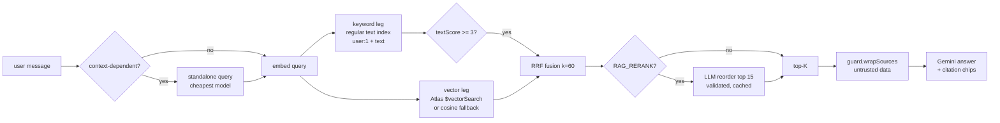
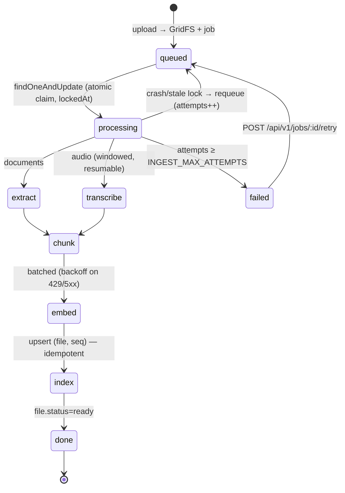

# Quantum — Unified AI Intelligence Suite

> **Where Artificial Intelligence, Knowledge, and Creativity Converge.**  
> *A production-grade AI workspace built with MERN, GenAI, and advanced data visualization.*

---

## Overview

**Quantum** is a **full-scale AI Intelligence Suite**, not just a chatbot.

It is designed as a **single unified workspace** where users can:

- Converse intelligently with AI  
- **Chat with their own documents** via a full **RAG (Retrieval-Augmented Generation)** pipeline  
- Analyze documents and content deeply  
- Visualize knowledge and insights in **2D & 3D**  
- Generate executive summaries and strategies  
- Create AI-generated images using diffusion models  
- Securely manage data with **enterprise-grade authentication**

This project demonstrates **real-world system design, AI orchestration, security engineering, and polished UX** — exactly what recruiters look for beyond basic demos.

---

## Live Demo

🔗 **Quantum AI:**  
 https://quantum-chat-frontend.onrender.com/login

---

## Why Quantum Stands Out

- End-to-end **MERN Stack** architecture  
- Full **RAG pipeline** — embeddings, vector search, and grounded chat over your own files  
- Multiple **AI systems orchestrated together**  
- Secure **OAuth + JWT hybrid authentication**  
- Advanced **3D knowledge graphs & analytics**  
- Integrated **AI Image Generation (NeuraPix)**  
- Product-level **UI/UX & workflow design**  
- **Production-ready deployment** mindset  

---

## Core Modules

---

## Authentication & Security System (Enterprise-Grade)

Quantum is built with a **security-first architecture**, clearly demonstrated by its authentication flows.

### Features
- Email & Password authentication  
- OAuth 2.0 login with **Google** and **GitHub**  
- Secure **Sign Up / Sign In / Forgot Password** flows  
- Encrypted password storage using **bcrypt**  
- Password reset via **secure email token (SMTP)**  

### Security Design
- **JWT Access Tokens** (15 minutes)  
- **JWT Refresh Tokens** (15 days)  
- Tokens stored in **HttpOnly cookies** (XSS-safe)  
- **Helmet.js** for secure headers (CSP, XSS, CSRF)

*Screenshots show clean, professional authentication UI — exactly what production apps require.*

---

## Quantum Chat — Context-Aware Conversational AI

> An intelligent assistant designed for **deep reasoning, learning, and productivity**.

### Capabilities
- Context-retaining multi-turn conversations  
- **Token-by-token streaming** over SSE (`POST /api/v1/chat/:chatId/stream`) with a Stop button — aborted answers persist as *partial* so history is never inconsistent; falls back automatically to the classic endpoint  
- **Personas** — built-in presets (Analyst, Tutor, Code Reviewer, Executive Briefer) plus custom ones via `/api/v1/personas`; applied per chat but can never override the injection guardrails  
- **Chat organization** — pinned chats, tags + tag filtering, inline-renamable titles, and auto-generated titles on the cheapest model  
- Coding help, explanations, reasoning, and creativity  
- Chat history persisted in **MongoDB**  
- File-aware intelligence (chat with documents)  

### Unique Feature
- **One-click conversion of conversations into structured mind maps** using **Mermaid.js**, enabling visual understanding of complex topics.

---

## RAG Engine — Chat With Your Documents

> Ask questions and get answers **grounded in your own files**, powered by a full Retrieval-Augmented Generation pipeline.

### Ingestion Pipeline
- Upload **PDF / DOCX / TXT / MD / CSV / JSON** files  
- Documents are parsed into structured `Document` objects with metadata (`utils/dataLoader.js`)  
- **Recursive text chunking** (1000 chars, 200 overlap) preserves context across chunk boundaries (`utils/chunker.js`)  
- Each chunk is embedded with **Gemini Embedding** (`EMBEDDING_DIMS`, 768 by default) and stored in a `chunks` collection — dimension/model metadata is tracked per chunk so stale vectors are detected, not crashed on  

### Retrieval
- Queries are embedded and matched against your indexed chunks (`utils/retriever.js`)  
- **MongoDB Atlas `$vectorSearch`** as the primary path (auto-created index)  
- **Local cosine-similarity fallback** — works on any MongoDB, no Atlas required  
- Similarity threshold (`RAG_MIN_SCORE`) filters out irrelevant context  
- **Optional hybrid retrieval** (`RAG_HYBRID`): a regular MongoDB **text index**
  `{ user: 1, text: "text" }` runs an owner-scoped keyword leg in parallel,
  fused with the vector leg via **Reciprocal Rank Fusion** (`RAG_RRF_K=60`).
  The keyword leg is a *rescue* leg for exact identifiers — a strict
  textScore admission threshold (`RAG_KEYWORD_MIN_SCORE=3`) and a lower RRF
  weight keep lexical noise out. Every filter (owner, READY files, file
  scoping, embedding model/dims) applies identically to both legs, and the
  keyword leg still works when the vector index is missing.
- **Query rewriting** (`RAG_REWRITE`, default ON): context-dependent
  follow-ups ("How long does *it* take?") are condensed into standalone
  queries using the last 4 turns as data — for retrieval only; the stored
  message is untouched and failures fall back to the original. Measured
  +0.045 overall MRR (follow-up category 0.40 → 0.70).
- **Optional LLM rerank** (`RAG_RERANK`, default OFF): reorders the top 15
  fused candidates on the cheapest model with a 4s timeout, ID-subset
  validation, and a 1h Mongo cache. Measured: identical MRR for +1 call/query
  and ~400ms — off until it earns its cost.



### Chat Integration
- Retrieval runs **automatically** when you have indexed documents — just ask  
- Scope answers to **specific documents** via the Knowledge Base picker (`documentIds`)  
- **Temporary attachments** (`saveToKB: false`) are never indexed and are deleted after the message  
- Tunable via env vars: `RAG_TOP_K`, `RAG_MIN_SCORE`, `MAX_ATTACH_CHARS`  

---

## Insight Engine — Deep Content & Knowledge Intelligence

> Transform raw text into **actionable intelligence**.

### Features
- Readability analysis (Flesch–Kincaid)  
- Tone & sentiment analysis  
- Estimated reading time  
- Entity extraction (organizations, concepts, topics)  
- **Interactive 3D Knowledge Graphs**  
- **Content DNA radar charts**

### Visualization Stack
- **Plotly.js** — 3D entity relationships  
- **Chart.js** — radar & analytics charts  

### Use Cases
- Market & business analysis  
- SEO & content evaluation  
- Academic research  
- Strategic writing  

---

## Quantum Studio — Document Intelligence Workspace

> A powerful learning and research environment.

### Capabilities
- Upload multiple documents (**PDF / TXT / DOCX**)  
- Compare documents side-by-side  
- Generate structured summaries  
- Auto-create **flashcards** for revision  
- Ideal for exams, research papers, and knowledge synthesis  

---

## NeuraPix — AI Image Generation Studio (Integrated)

**NeuraPix**, your previous AI Image Generator project, is now **fully integrated into Quantum** as a creative intelligence module.

### Features
- Text-to-image generation  
- Powered by **Stable Diffusion via Hugging Face**  
- Prompt-driven creative workflows  
- High-quality AI-generated visuals  

### Why This Matters
This demonstrates:
- Modular system design  
- Reusability of prior projects  
- Real-world integration of **GenAI pipelines**

---

## Knowledge Base — Persistent AI Memory

> Your personal AI knowledge repository.

### Features
- Stores uploaded files & insights  
- Files are **automatically indexed for RAG** on upload (chunked + embedded)  
- Select specific documents to **scope chat retrieval** to just those sources  
- Global search across workspace  
- Acts as long-term AI memory  
- Enables reuse of past intelligence  

---

## Executive Assistant — Strategy & Decision Intelligence

> AI outputs designed for **business and leadership contexts**.

### Outputs
- Executive summaries  
- Action items  
- Strategic gaps & risks  
- Decision-ready insights  

---

## AI & Intelligence Stack

| Function | Technology |
|--------|------------|
| Conversational AI | Google Gemini Pro |
| Embeddings & RAG | Gemini Embedding + MongoDB Atlas Vector Search |
| Document Parsing | pdf-parse, Mammoth (DOCX) |
| Image Generation | Hugging Face (Stable Diffusion) |
| NLP & Analysis | Natural, Sentiment.js |
| Knowledge Graphs | Plotly.js (3D) |
| Visualization | Chart.js, Mermaid.js |

---

## Tech Stack

### Frontend
- React.js 18  
- React Router v6  
- Tailwind CSS + Emotion  
- Material UI (MUI v5)  
- Framer Motion (animations)  
- Plotly.js (3D graphs)  
- Mermaid.js (mind maps)

### Backend
- Node.js  
- Express.js  
- MongoDB Atlas  
- Mongoose ODM  
- JWT + Passport.js  
- Nodemailer (SMTP)  
- OAuth 2.0 (Google & GitHub)

---

## Architecture Philosophy

- Modular & scalable backend  
- Clear separation of concerns  
- API-first design  
- Stateless authentication  
- Cloud-deployment ready  

---

## Engineering Challenges & Learnings

- Designing secure OAuth + JWT token rotation  
- Managing long AI conversation context efficiently  
- Rendering performant 3D knowledge graphs  
- Orchestrating multiple AI services in a unified UX  
- Handling SPA routing & OAuth redirects in production  

---

## High-Level Architecture

```text
Frontend (React)
   ↓
Backend (Express API)
   ↓                    ↘
AI Services      RAG Pipeline
(Gemini,         (Loader → Chunker →
Hugging Face)     Embedder → Retriever)
   ↓                    ↙
MongoDB Atlas (docs + vector index)
```
---
## Quality, Testing & Observability

Quantum treats RAG quality as a *measured* property, not a hope.

### Tests
```text
npm test          # Vitest + Supertest + in-memory MongoDB — fully offline
npm run test:watch
```
Covers auth flows (register/refresh/reject), cross-user ownership isolation,
chunker behavior, the retriever's cosine fallback when Atlas `$vectorSearch`
is unavailable, and file-stream privacy. A deterministic Gemini mock
(`GEMINI_MOCK=1`) means CI needs no API key. GitHub Actions runs tests on
every PR and builds the client.

### Health & usage
- `GET /health` — `{status, uptimeSec, version, db:{ok,latencyMs}, vectorIndex, models}`; 503 when the DB is down.
- Every Gemini call writes a `UsageEvent` (kind, model, tokens, latency, requestId) — see `GET /api/v1/usage/me` and the Usage panel on the dashboard.
- Structured logs via pino with `x-request-id` correlation end to end.

### RAG eval harness
```text
npm run eval              # against MONGO_URI (or EVAL_MONGO_URI)
node scripts/eval.js --memory   # fully self-contained (in-memory DB)
```
Runs the real retrieval + generation path against `evals/fixtures/` and
`evals/golden/questions.json` (including unanswerable and prompt-injection
cases), scoring **hit@k, MRR, faithfulness, relevance, fact coverage,
abstention accuracy, and injection-safety**. Reports land in
`evals/reports/`; the run fails if a metric regresses more than
`EVAL_REGRESSION_THRESHOLD` vs `evals/baseline.json`.

A second, retrieval-only stress harness (`npm run eval:retrieval`, or
`scripts/gen-retrieval-fixtures.js` + `scripts/eval-retrieval.js`) measures
40 labelled queries over 40 self-written distractor documents across five
categories — paraphrase, exact-identifier, multi-document, near-duplicate,
and pronoun-dependent follow-ups — and caches query embeddings on disk so
reruns cost zero API calls.

### Retrieval ablation (40-query stress set, in-memory)

| config | hit@1 | hit@3 | hit@5 | MRR | p50 | extra calls/query |
|---|---|---|---|---|---|---|
| vector-only (baseline) | 0.83 | 0.90 | 0.95 | **0.87** | 586ms | 0 |
| keyword-only | 0.33 | 0.38 | 0.38 | 0.35 | 8ms | 0 |
| hybrid (RRF k=60) | 0.83 | 0.90 | 0.95 | 0.87 | ~20ms | 0 |
| hybrid + rerank | 0.83 | 0.90 | 0.95 | 0.87 | ~450ms | +1 |
| vector + rewrite (live) | **0.88** | **0.95** | **0.98** | **0.92** | — | ~0.15* |

*rewrite only fires on context-dependent follow-ups (~6/40 queries);
follow-up category MRR 0.40 → 0.70. Default config: **vector + rewrite ON,
hybrid and rerank OFF** — hybrid never beat vector-only on this set and
rerank buys no MRR; both stay opt-in. See `docs/DECISIONS.md`.

| metric | Phase 0 (no guardrails) | Phase 1 (guardrails on) | Phase 3B |
|---|---|---|---|
| hit@k | 0.95 | **0.95** | **0.97** |
| MRR | 0.89 | **0.93** | **0.93** |
| faithfulness | 0.86 | **0.98** | **0.95** |
| relevance | 0.95 | **1.00** | **1.00** |
| fact coverage | 0.91 | **1.00** | **0.97** |
| abstention accuracy | 0.75 | **1.00** | **1.00** |
| injection-safe | 0.50 | **1.00** | **1.00** |
| timestamp citations | — | — | **1.00** |
| page citations | — | — | **1.00** |
| image QA | — | — | **1.00** |
| table queries | — | — | **1.00** |
| mean latency | 6.9s | 14.9s* | 9.6s* |

*includes free-tier 429 back-off during the run; not regression-gated.

Phase 3B agent metrics (11 cases in `evals/golden-agent.json`):
tool-selection **1.0** · avg steps **2.5** · content accuracy **1.0** ·
abstention **1.0** · injection-safe **1.0** — including `analyze_table`
calling a CSV analyst over `sales.csv`.

Guardrails (Phase 1): every retrieved chunk/attachment is wrapped in
`<source>` delimiters, delimiter-like text inside sources is neutralized,
instruction-like content is flagged (shown on the citation chip, never
obeyed), and the guardrail block is the last — authoritative — part of the
system instruction so personas can't override it.

---

## Agent Mode — Multi-Step Tool Use

Switch the composer from **Chat** to **Agent** and the assistant becomes a
tool-using agent on the same streaming endpoint
(`POST /api/v1/chat/:chatId/stream` with `{mode:"agent", browse:bool}`).
The loop is `model → function calls → server-side tools → results back →
repeat` until a final answer — capped by `AGENT_MAX_STEPS` (5),
`AGENT_TIMEOUT_MS` (45s) and `AGENT_MAX_TOOLS_PER_STEP` (3). On any limit it
forces a final answer from gathered context; Stop/disconnect aborts the
whole run and still persists the partial answer **with its trace**.

| tool | what it does |
|---|---|
| `search_knowledge_base` | RAG over the user's documents (owner-scoped; foreign `fileIds` silently dropped) |
| `list_documents` | the user's files — id, name, kind, status (≤50) |
| `get_document_overview` | cached per-document summary (generated once on the cheapest model) |
| `create_flashcards` | generates + persists a study deck (≤20 cards) |
| `analyze_table` | stub — `{ok:false, "not available yet"}` (wired in Phase 3.4) |
| `web_search` | Google Search grounding — registered only when **Browse** is on, `WEB_SEARCH_DAILY_CAP` per user/day |

**Safety:** tool args are validated with zod; every tool result passes
through `guard.js` (untrusted-data wrapping + injection detection) before
going back to the model; `userId` is server-injected, never taken from the
client or the model. `FEATURE_AGENT=false` disables cleanly and hides the UI.

Every tool call streams live events (`tool_call`/`tool_result`) and the
answer keeps a persisted, collapsible **"How I got this answer"** timeline:

```text
▾ How I got this answer (2 steps)
  ⚙ search_knowledge_base      41ms
      {"query":"apollo 11 crew","topK":5}
      3 chunk(s) retrieved
  ⚙ web_search                 1180ms
      {"query":"apollo 11 50th anniversary"}
      answer + 2 source(s) (19 quota left)

[example.com] [nasa.gov]      ← web sources render as domain chips
[apollo_history.txt • 82%]    ← KB citations render as before (⚠ when flagged)
```

### Re-embedding migration
If `EMBEDDING_DIMS` or `GEMINI_EMBEDDING_MODEL` ever changes, existing chunks
must be re-embedded (the retriever ignores mismatched-dimension vectors):
```text
node scripts/reembed.js --dry-run   # preview what would be re-embedded
node scripts/reembed.js             # batched, resumable, idempotent
```

---

## Ingestion pipeline — resumable jobs, GridFS, audio

Uploads are stored in **GridFS** (bucket `uploads`) — never on the app's
ephemeral disk — then ingested by an in-process job runner as an
`IngestionJob`. `POST /api/v1/files/upload` returns `202 {fileId, jobId}`;
`INGEST_SYNC=true` keeps the old synchronous `201` contract for tests and
small files.



- **Progress**: `GET /api/v1/files/:id/ingestion/stream` (SSE, owner-only,
  heartbeats) or `GET /api/v1/jobs/:id` polling; failed jobs can be retried
  via `POST /api/v1/jobs/:id/retry`. The Knowledge Base shows live progress
  bars and a Retry action.
- **Resumable**: chunk writes are idempotent upserts keyed `(file, seq)`;
  transcript windows persist per-job so a restart never redoes them. Stale
  `processing` locks are requeued at boot (`INGEST_STALE_MS`); SIGTERM
  releases in-flight claims back to `queued`.
- **Readiness**: files carry `status: processing|ready|failed` — only
  `ready` files are retrievable by RAG and agent tools (`list_documents`
  still shows them with their status).
- **Storage safety**: per-user cap `USER_STORAGE_MAX_MB` (100MB default);
  deleting a file removes its GridFS blob, chunks and jobs; legacy disk
  files migrate via `node scripts/migrate-to-gridfs.js [--dry-run]`.
- **Privacy**: files stream through `GET /api/v1/files/:fileId/view`
  (ownership-checked, HTTP **Range** support — no public URLs).

### Audio → transcript → meeting minutes

- **Formats**: mp3 / m4a / wav / ogg / flac, validated by **magic bytes**;
  caps `AUDIO_MAX_MB` (25) and `AUDIO_MAX_MIN` (30), duration read
  server-side via `music-metadata`.
- **Transcription**: `GEMINI_TRANSCRIBE_MODEL` (verified via `listModels`
  at boot, falls back to the chat model). Small files go inline; larger
  ones use the **Gemini Files API**, always deleted in `finally`. Long
  audio is transcribed in `AUDIO_SEGMENT_SEC` windows — each window is a
  resumable checkpoint on the job.
- Transcripts are grouped into ~1000-char chunks carrying
  `metadata.startSec/endSec/speakers`, pass through the same
  `guard.js` injection screening as any source, and produce **mm:ss
  citation chips** that seek the authenticated player.
- **Meeting Minutes** (Executive Assistant):
  `POST /api/v1/openai/meeting-minutes` returns structured
  `{summary, decisions[], actionItems[{owner,task,due?,sourceSec?}],
  openQuestions[], risks[]}` — every item carries a seekable timestamp
  chip; client-side Markdown export included.
- `FEATURE_AUDIO=false` disables the pipeline and hides the UI.

---

## Multimodal ingestion — page citations, images, deep analysis

- **Page-level citations**: PDFs are chunked per page — a chunk never
  spans pages and carries `metadata.page`. Citation chips render `p.N`
  and open an authenticated `pdfjs-dist` viewer at that page. Pages below
  `PDF_MIN_PAGE_CHARS` are recorded on `File.pagesWithoutText`; the KB
  card shows *"N pages look scanned — run Deep analysis to read them."*
  PDFs ingested before page metadata get a **Reprocess** action that
  regenerates text chunks only (figure chunks survive; a failed run keeps
  the old index).
- **Image ingestion** (`FEATURE_MULTIMODAL`, `IMAGE_MAX_MB=8`): png/jpg/
  jpeg/webp, validated by **magic bytes**. A `describe` stage produces a
  structured `{caption, ocrText, dataInsights, tags}` — stored on
  `File.description` and embedded as `type:"image"` chunks. OCR text is
  **untrusted**: it flows through the same `<source>` wrapping +
  injection detector as any retrieved data (visual prompt injection is
  real). Clicking an image citation opens the viewer showing the picture
  beside its description and extracted text.
- **Deep analysis** (`POST /api/v1/files/:id/deep-analysis {pageStart,
  pageEnd}`): user-triggered vision pass that reads figures, tables,
  charts and scanned pages in a PDF range — capped at
  `MULTIMODAL_MAX_PAGES` (20) per run and `DEEP_ANALYSIS_DAILY_CAP` (3)
  per user per day (TTL counter). `pdf-lib` slices ~5-page windows into
  small PDFs for Gemini; structured output maps back to original page
  numbers and lands as `type:"figure"` chunks (scanned_text → text
  chunks), resumable per window and idempotent on rerun. Results are
  citable — "what does the chart on page 4 show?" returns a `p.4` chip.

## Ask your data — the CSV analyst

Every CSV gets a streaming column profile at ingest (`tableMeta` —
types, nulls, min/max/mean, top values, `TABLE_MAX_ROWS` cap).

**"Ask your data"** on any CSV card asks a question in plain English:

```text
"average revenue by region as a bar chart"
  → Gemini emits a STRUCTURED spec (never code):
    {groupBy:["region"], aggs:[{col:"revenue",fn:"avg"}],
     orderBy:{col:"avg_revenue",dir:"desc"}, chart:{type:"bar",...}}
  → services/tableQuery.js validates every column/op against the
    allow-list, then executes it in plain server code over a fresh
    streaming parse (row + TABLE_QUERY_TIMEOUT_MS caps)
  → {rows, rowCount, truncated, chartSpec} + a one-line explanation
```

The panel shows the generated spec collapsibly ("how I computed this"),
the result table, and an editable-type Plotly chart. Malformed specs get
a friendly retryable error. `analyze_table` gives the **agent** the same
capability with identical validation and ownership checks. No
`eval`/`Function`, no model-written queries, `contains` is a substring
never a RegExp, and group keys are `Map`-safe against `__proto__`
columns.

---
## Local Setup
```text
git clone https://github.com/rohit02k5/QUANTUM-CHAT-AI-WORKSPACE.git
cd QUANTUM-CHAT-AI-WORKSPACE
```

Environment
```text
cp .env.example .env   # then fill in your values (Mongo URI, Gemini key, OAuth, SMTP, JWT secrets)
```

Backend
```text
npm install
npm run server   # http://localhost:8080
```
Frontend
```text
cd client
npm install
npm start        # http://localhost:3000 (proxies /api → :8080)
```
Deployment Ready
Quantum is production-ready and designed for deployment on platforms like Render or Vercel.

SPA routing handled correctly

OAuth redirect-safe

Environment-based configuration

Secure CORS policies


Screenshots & UI Highlights

Screenshots demonstrate authentication flows, AI chat, document intelligence, 3D graphs, and executive insights.


Authors

**Swarna Venkata Sai Rohit** and **Harshita**

GitHub: https://github.com/rohit02k5

GitHub: https://github.com/harshita-sl
